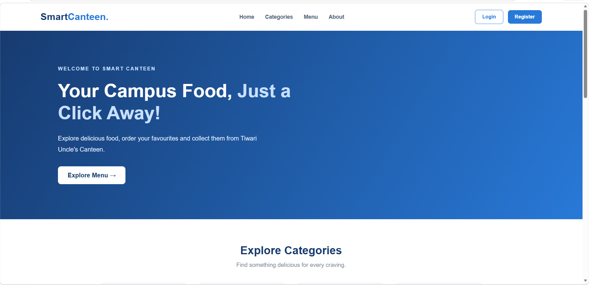
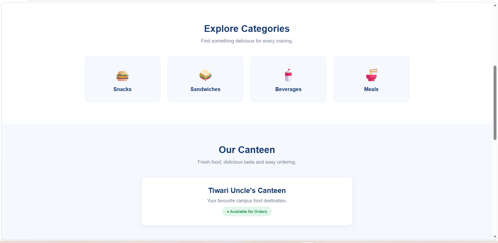
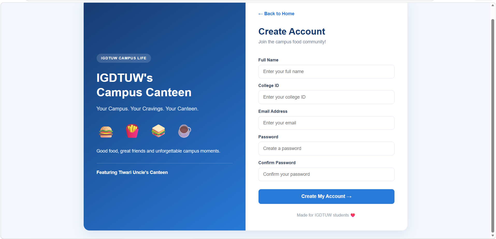
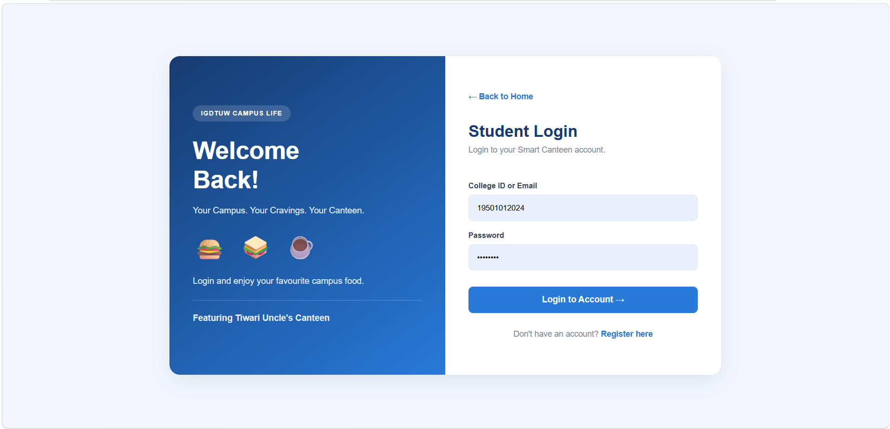
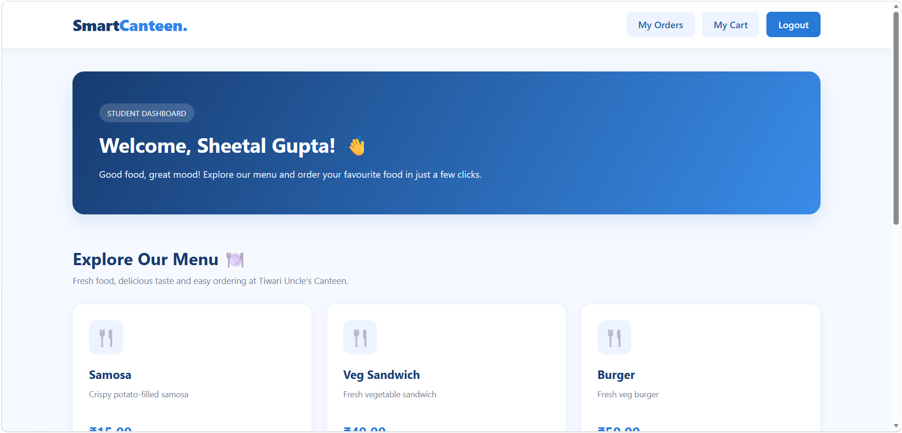
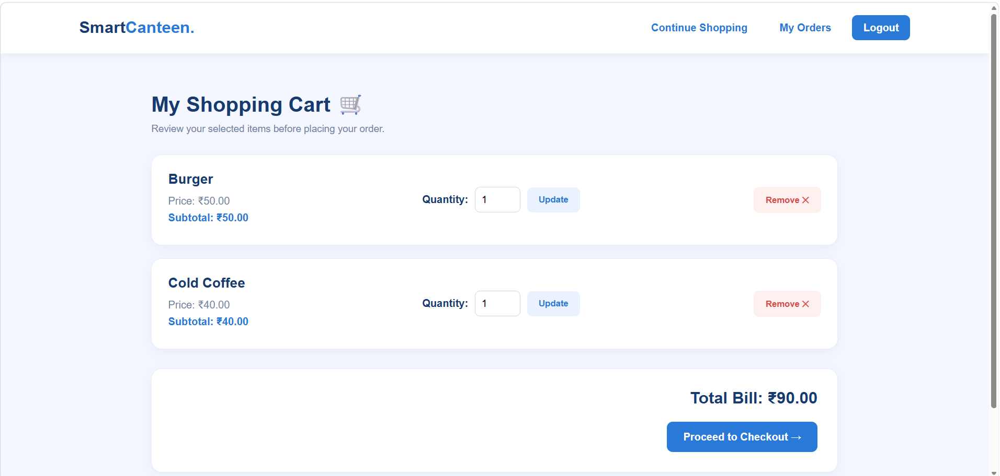
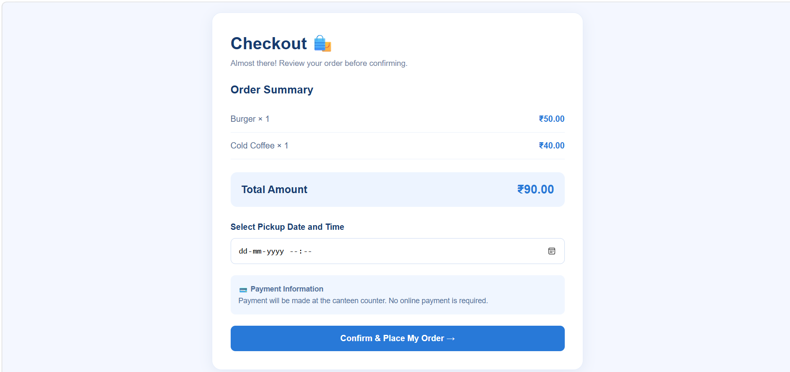
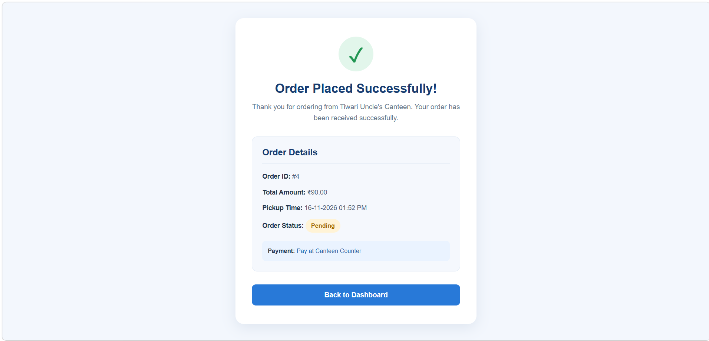
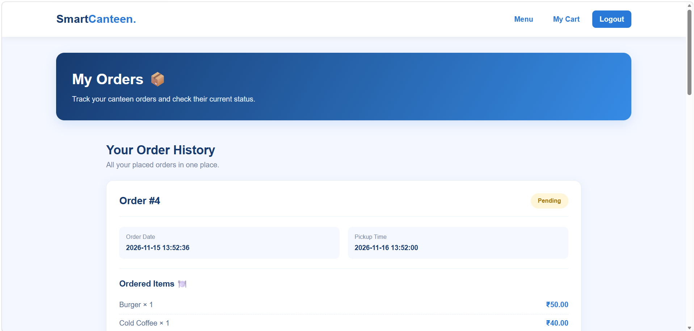
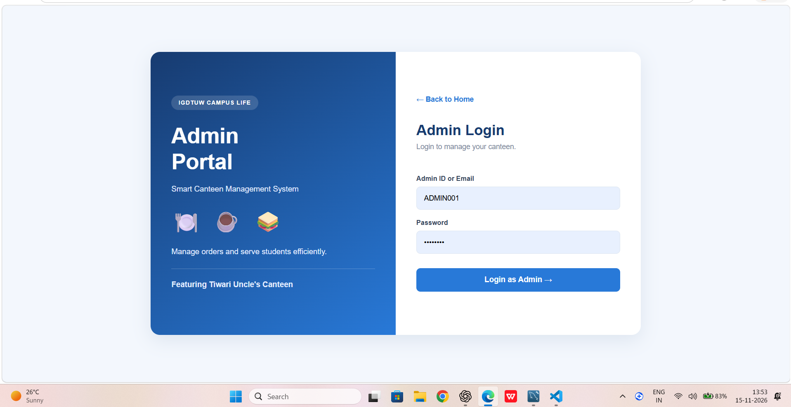

# 🍽️ Smart Canteen Ordering and Management System

A web-based Smart Canteen Management System that simplifies food ordering and order management for students and canteen administrators.

The system allows students to browse food items, add products to their cart, place orders, select pickup times, and track their order status. Administrators can manage incoming orders and update their preparation status.

## 🚀 Features

### 👨‍🎓 Student Module
- Student registration and login.
- Browse available food items.
- View item details and prices.
- Add items to cart.
- Update item quantities and remove items.
- Place food orders.
- Select preferred pickup time.
- View order history.
- Track order status.

### 👨‍💼 Admin Module
- Secure admin login.
- View all incoming orders.
- View student and order details.
- Accept or reject pending orders.
- Set estimated preparation time.
- Update order status:
  - Pending
  - Accepted
  - Preparing
  - Ready for Pickup
  - Completed
  - Rejected

## 📸 Project Screenshots

### 1. Homepage


### 2. Menu


### 3. Student Registration


### 4. Student Login


### 5. Student Dashboard


### 6. Shopping Cart


### 7. Checkout


### 8. Order Success


### 9. My Orders


### 10. Admin Login


## 🛠️ Technology Stack

| Technology | Purpose |
|---|---|
| HTML5 | Website structure |
| CSS3 | Styling and responsive UI |
| JavaScript | Frontend interactions |
| Python | Backend programming |
| Flask | Web framework |
| MySQL | Database management |
| Jinja2 | Dynamic HTML rendering |
| Werkzeug | Password hashing |
| Git & GitHub | Version control |

## 🗄️ Database Structure

The project uses MySQL with the following main tables:

- `users` – Stores student and admin account details.
- `menu_items` – Stores food item information.
- `orders` – Stores order details and status.
- `order_items` – Stores individual items associated with each order.

## ⚙️ Installation and Setup

### 1. Clone the Repository

```bash
git clone https://github.com/PriyaEngineer/Smart-Canteen-System.git
```

### 2. Open the Project Directory

```bash
cd Smart-Canteen-System
```

### 3. Install Dependencies

```bash
pip install flask mysql-connector-python python-dotenv
```

### 4. Configure MySQL

- Install and start MySQL Server.
- Create the database named `smart_canteen`.
- Create the required tables.
- Configure database credentials using a local `.env` file.
- Never upload your `.env` file to GitHub.

### 5. Configure Admin Account

Run the admin password hashing utility:

```bash
python create_admin.py
```

Use the generated password hash when creating the admin account in the database.

### 6. Run the Application

```bash
python app.py
```

Open your browser and visit:

```text
http://127.0.0.1:5000/
```

## 🔐 Security

- Passwords are stored using secure password hashing.
- Student and admin sessions are managed separately.
- Student order history is restricted to the logged-in student.
- Database credentials are maintained outside the source code.

## 💳 Payment Method

Currently, the system supports payment at the canteen counter.

## 🔮 Future Enhancements

- Online payment gateway integration.
- Cloud deployment.
- Email and order notifications.
- Real-time order tracking.
- Admin menu management.
- Sales and order analytics.

## 👩‍💻 Project Information

**Project Name:** Cloud-Based Smart Canteen Ordering and Management System

**Developed for:** Tiwari Uncle's Canteen

**Repository:** https://github.com/PriyaEngineer/Smart-Canteen-System

---

⭐ If you find this project interesting, consider giving the repository a star!